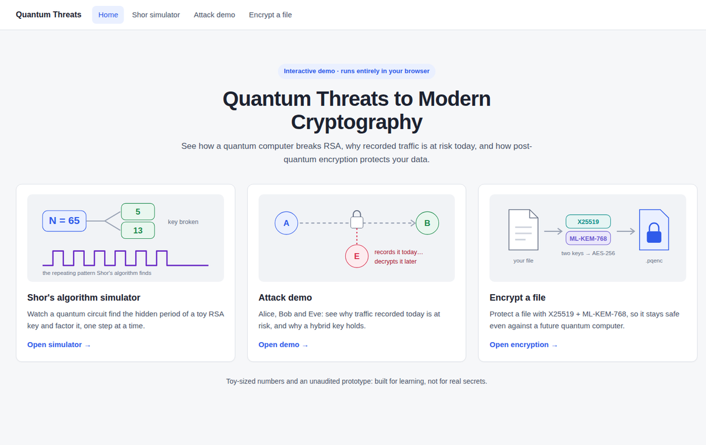
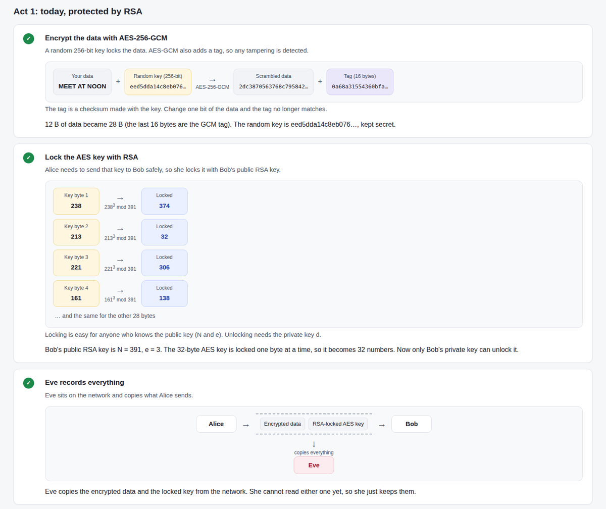
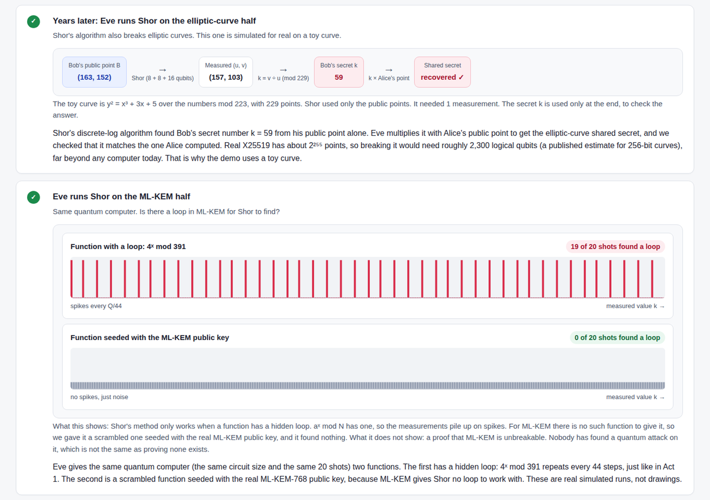

# Quantum Threats to Modern Cryptography

**An interactive way to learn how a quantum computer breaks RSA, and how post-quantum encryption keeps your data safe.**

Built with Astro, Svelte, TypeScript and Chart.js. Everything runs in your browser, and nothing is ever uploaded.



## What's inside

The site has three pages. Each one answers a different question.

| Page | The question it answers |
|---|---|
| **Shor simulator** | *How* does Shor's algorithm break an RSA key? |
| **Attack demo** | *What does that mean* for data we send today? |
| **Encrypt a file** | *How do we protect* a real file against it? |

### 1. Shor's algorithm simulator

Pick a toy RSA key and watch a simulated quantum circuit factor it, one step at a time.

- A Qiskit-style circuit diagram (Hadamards, controlled-U gates, QFT, measurement).
- Four charts that follow the algorithm: the repeating pattern `aˣ mod N`, then the counting register after each stage (superposition, modular exponentiation, QFT, measured shots).
- A guide that walks you through every step and shows the real numbers from your run: the loop length `r`, the gcd step, the factors, and the private key `d`.
- A beginner explainer, "How does this break RSA?", with a tiny worked example (N = 15).
- Noise settings and a noise sweep, to see how errors affect the result.


### 2. Attack demo

Follow one message (or file) through two attacks, one after the other.

- **Act 1, protected by RSA:** the data is encrypted with AES-256-GCM, the AES key is locked with RSA, Eve records it, years later Shor factors the key, and Eve decrypts everything.
- **Act 2, protected by the hybrid:** the same data is encrypted again, this time with a key from an elliptic-curve exchange + ML-KEM-768. Then Eve attacks it with real simulations:
  - Shor's *discrete-log* algorithm recovers the elliptic-curve secret from the public point alone (on a toy curve, since a simulator can't attack real X25519).
  - The same quantum period-finding is run on a function with a hidden loop and on one seeded with the real ML-KEM public key: spikes and valid loops on one, noise and none on the other.
  - Eve's key is still wrong, so AES-GCM rejects it. A control test shows the ML-KEM half is the only thing missing.

Every step has a small diagram built from the real numbers of that run, and every attack in the demo is a real computation, not a drawing.





### 3. Encrypt a file

A real, working hybrid encryption tool.

- Bob creates his X25519 and ML-KEM-768 key pairs.
- Alice encrypts any file in the browser: a fresh AES-256-GCM key is made from both key exchanges, and the file is saved as a `.pqenc` file.
- Bob decrypts it. A "change one bit" button shows AES-GCM catching tampering.


## How Shor's algorithm breaks RSA, in five lines

1. RSA's public key contains `N = p × q`, two secret primes. Breaking it means finding `p` and `q`.
2. Pick a number `a`. Keep multiplying by `a` (mod `N`) and the remainders loop back to 1 after `r` steps.
3. A quantum computer can find that loop length `r` quickly, using superposition and the quantum Fourier transform.
4. With `r`, a small gcd calculation gives `p` and `q`.
5. With `p` and `q`, the private key follows, and every message can be read.

## Getting started

You need **Node 22.18 or newer**. The project includes an `.nvmrc` for Node 24.

```bash
nvm use            # optional, picks Node 24
npm install
npm run dev        # http://localhost:4321
```

Other commands:

```bash
npm run build      # static site in dist/
npm run preview    # serve the built site
npm run check      # strict type check of .ts, .svelte and .astro files
npm test           # 27 simulator + 16 hybrid protocol + 15 elliptic-curve and attack checks
npm run test:real  # same protocol with the real ML-KEM-768 + X25519
```

If `npm run dev` shows a blank page right after you install a new package, stop the server, delete `node_modules/.vite`, and start it again.

## Project structure

```
src/
  pages/            the four pages (home, simulator, attack, encrypt)
  components/       Simulator.svelte, Attack.svelte, AttackViz.svelte, Encrypt.svelte
  lib/
    shor-core.ts    the simulator engine: state vector, QFT, continued fractions, toy RSA
    shor-ecdlp.ts   Shor's discrete-log algorithm, simulated, for the toy elliptic curve
    shor-period.ts  period finding for any function (a loop vs. no loop)
    toy-ec.ts       the toy elliptic curve that stands in for X25519 in the attack demo
    simulator.ts    the simulator page logic
    charts.ts       bar and line charts (Chart.js)
    circuit.ts      the circuit drawing (SVG)
    hybrid.ts       hybrid key exchange + file format (X25519 + ML-KEM-768 + AES-256-GCM)
    suite.ts        the real crypto libraries (noble)
    attack-viz.ts   types for the attack demo diagrams
  styles/           global.css
test/               tests for the simulator and the hybrid protocol
docs/               developer notes and the screenshots above
```

- **How the pages fit together** and what each one should (and shouldn't) contain: [`docs/DEV-attack-and-encrypt.md`](docs/DEV-attack-and-encrypt.md).

## Built with

- [Astro](https://astro.build) and [Svelte 5](https://svelte.dev) for the site
- [TypeScript](https://www.typescriptlang.org) throughout
- [Chart.js](https://www.chartjs.org) for the charts
- [`@noble/post-quantum`](https://github.com/paulmillr/noble-post-quantum) for ML-KEM-768 and [`@noble/curves`](https://github.com/paulmillr/noble-curves) for X25519
- The browser's built-in Web Crypto for AES-256-GCM and HKDF

## Limits (please read)

- **This is a learning project.** The simulator runs on toy-sized numbers (N up to 511). It does not break real RSA, and it makes no claim about quantum speed-up.
- It is a classical program that simulates an ideal quantum circuit. The modular exponentiation step is computed with normal code, which a real quantum machine would have to do with many extra qubits and gates.
- A real attack on RSA-2048 needs a large, fault-tolerant quantum computer that does not exist today. A 2025 estimate by Gidney puts it at under a million noisy qubits ([arXiv:2505.15917](https://arxiv.org/abs/2505.15917)).
- In the attack demo, X25519 is replaced by a **toy elliptic curve with 229 points**, because no simulator can attack the real curve (about 2²⁵⁵ points; published estimates say roughly 2,300 logical qubits). The Encrypt page still uses the real X25519.
- Shor's algorithm does not apply to ML-KEM, because there is no hidden loop to find. The ML-KEM experiment gives Shor a scrambled function seeded with the real public key and shows it finds nothing. **That is a real run, but it is not a proof** that ML-KEM is secure. No quantum attack is known, which is not the same as none existing.
- The encryption tool has **not been audited**. Do not use it for real secrets.

## Why it matters

Encrypted data can be recorded today and decrypted later, once a quantum computer exists. This is often called "harvest now, decrypt later", and it is why moving to post-quantum encryption such as ML-KEM matters now.
